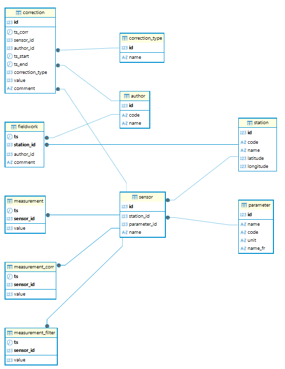

<!-- README.md is generated from README.Rmd. Please edit that file -->

```{r, include = FALSE}
knitr::opts_chunk$set(
  collapse = TRUE,
  comment = "#>",
  fig.path = "man/figures/README-",
  out.width = "100%"
)
```

# corvus <a href=""></a>

<!-- badges: start -->
<!-- badges: end -->

corvus is a measurement stations managing application. The app is built with the {shiny} package and uses a PostgreSQL database with the TimescaleDB extension. The app is designed to manage measurement stations and their time series data. The app allows to insert, update and delete data. The app also allows to visualize the data with different plots, make correction and validation.

## Todo

- Be able to remove a correction (from cascade from the table)
- Add qualification when editing (see chartre qualité de l'hydrométrie) to edit different products :
  - first => raw data => status = "non qualify"
  - corrected data = visual inspection and manual correction by fieldwork knowledge. 
    - Correction apply to offset, drift, remove obvious ouliers or sensor failure range.
    - Data could be interpolate if remove on short period and if there is no reason to see trend changes.
    - Data status are then "controled and corrected" and with a quality flag
  - filtered data => apply filter and/or smoothing algorithms to identify outliers, remove noises, smoothing sensor uncertainty. It is only on "controled and corrected" data. Data status are then "filtered and smoothing data". Data could be interpolate at this stage.
- Add quality flag : 
  - good
  - uncertain
  - non qualify
- Add fieldwork add module
- Add sampling
- identify fieldwork when selected in table
- edit = set below/above value
- PI drift

## Installation

### Install package from GitHub

``` {r, eval=FALSE}
remotes::install_github("https://github.com/gehco-univ-tours/corvus.git")
```

### Install PostgreSQL timescaleDB database

- Install PostgreSQL latest version compatible with TimescaleDB extension. See the version compatibility in [TimescaleDB install documentation](https://docs.timescale.com/self-hosted/latest/install/) for your operating system. The PostgreSQL version for each operating system are [here](https://www.postgresql.org/download/).
- Install TimescaleDB extension following the [installation documentation](https://docs.timescale.com/self-hosted/latest/install/).
- With Docker you can follow this [guide](https://docs.timescale.com/self-hosted/latest/install/installation-docker/).
  - The app has been tested with the latest-pg16 version of the [TimescaleDB Docker timescale/timescaledb-ha image](https://hub.docker.com/r/timescale/timescaledb-ha).
  - docker-compose.yml example :

```{yml, eval=FALSE}
timescaledb:
    image: timescale/timescaledb-ha:pg16
    container_name: timescaledb
    ports:
      - "5434:5432"
    volumes:
      - ./timescaledb_data:/var/lib/postgresql/data
    environment:
      - POSTGRES_PASSWORD=my_password
      - POSTGRES_DB=my_first_db
      - POSTGRES_USER=my_user
```

### Create database

- Create an empty database with TimescaleDB extension.
- The database structure : 

- Create database infrastructure with the SQL script in the `inst/sql` folder or in the package with the following command:
```{r, eval=FALSE}
library(corvus)
system.file("sql", "db_model_pg_timescale.sql", package = "corvus") # file to create an empty database
system.file("sql", "db_data_example.sql", package = "corvus") # file to add example data
```
## Run app

```{r, eval=FALSE}
corvus::run_app()
```

## Insert data


## How to cite

Manière, L. (2024). corvus (Version 0.0.0.9000) [Computer software]. https://github.com/gehco-univ-tours/corvus

## Licence

This program is released under the GNU Public License v3.

